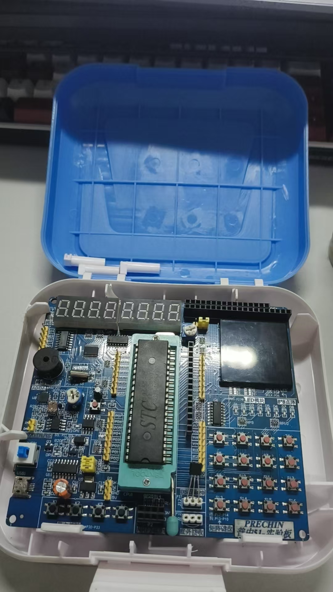

# 51 蜂鸣器音乐实验

通过 Timer0 中断翻转 P2.5 产生方波，改变定时器重装值控制音高，再按音符与时值数组顺序播放《起风了》的参考旋律。当前程序启动后播放一次，结束后停止，没有实现按键暂停、选曲或自动循环。

图：本人使用的普中 A2 开发板。实物照片展示硬件，不代表本次已经复测播放效果。

## 个人贡献

个人完成部分为参考旋律的音符、音区及节拍数据整理，数据位于 `mian.c` 的 `Music[]` 数组中。歌曲不是本人原创；基础驱动及播放框架参考学习例程，学习来源为[江协科技（原江科大自化协）51 单片机教程](https://www.bilibili.com/video/BV1Mb411e7re/)。

## 工程与硬件

| 项目 | 当前信息 |
|---|---|
| 开发环境 | Windows、Keil µVision、C51 工具链；ARM 工具链不能代替 C51 |
| 工程入口 | `project.uvproj`；主文件沿用原来的 `mian.c` 拼写 |
| 实际开发板 | 普中 A2 开发板 |
| 配套主控说明 | 按江科大课程配套的 STC89C52RC 说明；照片未能清晰读出实物芯片丝印，Keil 工程目标为 AT89C52 |
| 发声控制 | P2.5；实际器件、驱动电路和静音电平按开发板原理图确认 |
| 音高与延时计算条件 | 12 MHz 外部晶振、12T；这是原代码采用的计算条件，不是从照片读出的实测参数。Keil 工程填了 24 MHz，该设置不能改变实物晶振 |
| 节拍方式 | `SPEED = 500`，软件延时目标为 `SPEED / 4 × 时值`；不代表精确实测时间 |

`Timer0_Init.c/.h` 用于定时器初始化，`DELAY.c/.h` 用于软件延时；`Buzzer`、`key`、`Nixie` 模块保留原工程引用，但当前音乐主流程没有调用它们的全部功能。

## 运行与验证

在 Keil 中打开工程，按实际硬件核对参数，重新构建并检查警告。工程配置会在本地生成 `Objects/project.hex`，再用实际芯片支持的烧录工具下载、复位并验证播放。

构建缓存、IDE 本机配置和原来的 `music1` 目录未整体纳入本仓库。源码保留原文件内容及编码，中文注释如显示异常，可尝试按 GBK 打开。

历史构建日志曾记录 0 个错误、3 个未调用函数警告。本次整理未重新编译、烧录或测量音高与节拍，旧构建结果不作为当前复测证明。开发板为普中 A2，已补充自己的实物照片；原代码中的 12 MHz 注释不等于已经核实所有同型号板子的晶振配置，迁移时需要按实际定时器时钟计算。

当前需要关注阻塞式播放、时钟参数、主循环与中断共享的音符索引、额外的 `FreqSelect++` 以及休止符的实际静音行为。这些是代码检查提出的关注点，不代表已观测到或修复了全部相应问题。

## 参考简谱与个人编谱笔记

| 材料 | 说明 |
|---|---|
| [《起风了》参考简谱](images/qifengle-reference.jpg) | 项目整理者从网络资料提供，并说明可以公开使用；保留原图署名，非本人原创谱面 |
| [音符—时值笔记](scores/qifengle-notes.txt) | 本人整理的原始编码笔记，不是可单独编译的 C 文件 |
| [编谱资料说明](scores/README.md) | 数据格式、笔记和当前播放数组的差异，以及来源说明 |

当前 `Music[]` 含 285 个音符—时值事件。笔记与当前程序的第 189～192 个事件存在差异，因此运行版本以 `mian.c` 中的数组为准。本次没有擅自修改原笔记或程序音谱。

## 配套文章

[CSDN：51 单片机播放《起风了》：从数字简谱到音符与节拍编码](https://blog.csdn.net/2301_76484443/article/details/167812943)。
