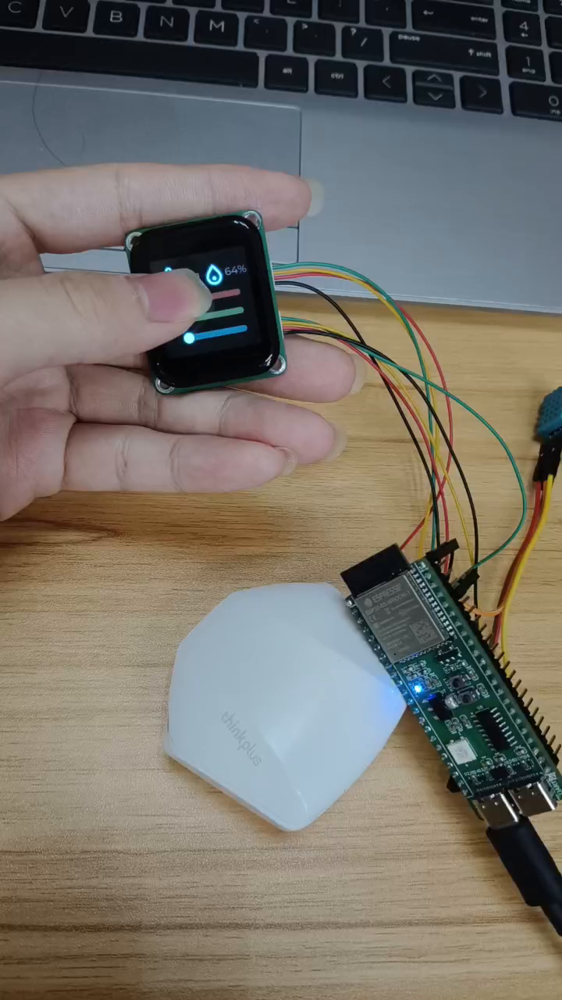

# ESP32-S3：LVGL 触摸调光与温湿度显示

使用自己设计的第一块 ESP32-S3 四层 PCB，搭建 LVGL 触摸调光与温湿度显示应用：ST7789 显示温湿度和三个 RGB 滑条，CST816T 提供触摸输入，滑条事件控制 WS2812，DHT11 提供温湿度数据。



[查看实机演示视频（约 14 秒）](demo/esp32-lvgl-rgb-panel.mp4)

## 功能、环境与接线

| 功能 | 实现位置 | 当前行为 |
| --- | --- | --- |
| 屏幕刷新与触摸 | `main/lv_port.c`、`components/bsp/st7789_driver.*`、`cst816t_driver.*` | 注册 LVGL 显示/指针设备；SPI 传输完成后通知 LVGL 可复用缓冲 |
| RGB 调光 | `main/ui_home.c`、`components/bsp/led_ws2812.*` | 三个滑条范围 0～255，值改变事件更新 RGB 通道，通过 RMT 发送 |
| 温湿度显示 | `main/ui_home.c`、`components/bsp/dht11.*` | LVGL 定时器每 2 秒请求读取；成功时更新标签 |
| 应用入口 | `main/main.c` | 初始化 LVGL、创建主页、循环处理 LVGL 任务 |

配置记录为 **ESP-IDF 5.3.1、ESP32-S3、LVGL 8.3.10、240×240 ST7789 SPI 屏、CST816T I²C 触摸**。LVGL 源码随 `components/lvgl/` 保存，当前应用使用自建主页，不是官方 widgets demo；配置仍保留 demo 与 examples 的编译开关。

| 设备 / 信号 | ESP32-S3 GPIO | 配置与说明 |
| --- | --- | --- |
| LCD MOSI / SCLK / CS | 13 / 14 / 15 | SPI2，配置频率 40 MHz；不使用 MISO |
| LCD DC / RST / BL | 2 / 4 / 10 | 高电平打开背光；模块电源按实物规格连接 |
| 触摸 SDA / SCL | 5 / 6 | I²C0，200 kHz，驱动地址 0x15 |
| DHT11 DATA | 18 | 单总线时序，RMT 接收；上拉及供电按模块规格核对 |
| WS2812 DATA | 38 | 当前配置 1 颗 LED；驱动内部按 GRB 顺序发送 |

以上取自当前代码，不从视频反推线色或排针编号。各模块须共地；核对供电和逻辑电平，不将 5 V 信号直接接入 ESP32-S3 GPIO。具体开发板型号及模块供电以自己的硬件为准。

## 编译与使用

从学习仓库进入 **`EPS32/learn/levgl_rgb/`**，或在 VS Code 单独打开这个目录；不要在整个学习仓库根目录执行此项目的 IDF 构建。在已配置好的 ESP-IDF 5.3.1 环境终端执行：

```sh
idf.py build
idf.py -p COMx flash monitor
```

将 `COMx` 替换为实际串口。VS Code 可直接使用 ESP-IDF 构建、烧录和监视按钮，目标选择 ESP32-S3。项目已提供 `sdkconfig` 和 `dependencies.lock`；首次构建不需要强制清配置，更换目标或修改 LVGL 选项前确认影响。

目录名为 `levgl_rgb`，而顶层 CMake 的 `project(levgl_test)` 沿用早期名称，因此正常产物叫 `build/levgl_test.bin`，不表示构建了别的工程。保留该名称是为了不改动已有可构建工程。

| 现象 | 原因 / 处理 |
| --- | --- |
| CMake 仍访问已不存在的 `.../levgl_button` | 旧 `build` 缓存保存了以前的绝对路径；删除或移走此项目旧 `build`，再构建生成当前路径的缓存 |
| 自定义 UI 与官方 demo 不同 | `app_main()` 实际调用 `ui_home_create()`，不调用 `lv_demo_widgets()` |
| 屏幕镜像、颜色不符 | 分别核对方向、色序、RGB565 字节序及反相模式，不将它们视作同一个开关，也不套用别的屏幕参数 |

## 显示配置与代码导航

当前驱动通过 `esp_lcd_new_panel_io_spi()` 创建 IO，再直接发送 ST7789 初始化和像素命令，**没有使用 `esp_lcd_new_panel_st7789()` 创建面板对象**。

| 配置 | 当前代码事实 | 使用边界 |
| --- | --- | --- |
| 像素格式 | `COLMOD=0x55`，LVGL 16 位色深 | RGB565 |
| 字节顺序 | `CONFIG_LV_COLOR_16_SWAP=y`，RAMCTRL 写入 `0x00,0xF0` | 字节交换不同于 RGB/BGR 通道顺序 |
| 显存访问控制 | `MADCTL` 最终固定为 `0x48` | 包含 MX 和 BGR 位；固定赋值覆盖了前面的 `spin` 分支结果 |
| 显示反相 | `INVON` 调用被注释 | 当前没有显式发送 `INVOFF`，不能写成已调用该命令 |
| 刷新缓冲 | 两块 240×40 像素的 DMA 缓冲 | RGB565 合计约 38,400 字节，不是两块全屏帧缓冲 |
| LVGL 时基 | `esp_timer` 每 5 ms 累加 tick，主循环约 10 ms 让出调度 | 这些是配置周期，不是实测帧率 |

`main/img/` 保存图标转换后的 C 数组；`ui_rgb.c` 是保留的早期按钮示例，当前入口未启用；`components/bsp/` 保存各设备驱动；`components/lvgl/` 保存实际构建使用的 LVGL 源码及许可证。

## 验证、限制与来源

作者确认项目在此前已经正常实现，附有当时拍摄的触摸调光与温湿度显示视频。2026-10-20 整理时遇到 CMake 旧绝对路径问题，删除旧 `build` 后由作者重新构建通过；**本次没有重新接线、烧录或上板复测**，不能把这次构建写成重新完成了实机验证。

这是功能学习记录，没有精度标定、刷新率、功耗、长时间可靠性或异常恢复的完整测量。DHT11 读取在 LVGL 定时器回调中执行，启动和等待可能阻塞 UI；读取失败时没有新增错误提示。本次不为开源整理重构这些行为，也不将“有演示视频”表述为量产验证。

LVGL、ESP-IDF 及带有原始版权头的驱动组件保留各自声明，不把官方库和示例整体归入个人原创。详见 [来源与第三方组件说明](THIRD_PARTY_NOTICES.md)。CSDN 对应文章待发布后补链接。
